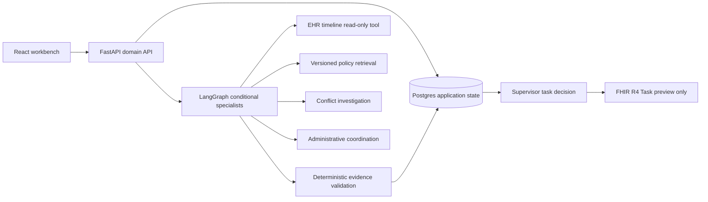

# Architecture: Product, boundaries, and ADRs

## Job to be done

A **fictional hospital's** authorized coordinator reviews a discharge case, reconciles structured status with an administrative discharge narrative, checks which follow-up information is missing and proposes administrative tasks. A supervisor approves or rejects the exact draft. The system never determines medical safety or appropriateness of discharge.

## Primary flow

## State and ownership

- `users`: password hash and tenant-scoped permissions.
- `cases`: synthetic source payload, latest evidence and findings, monotonically increasing plan revision.
- `tasks`: proposed tasks and their final reviewed status. `(case_id, task_key)` is unique; decided drafts are not duplicated on rerun.
- `audit_events`: append-only via application pathways; production must use stronger tamper-evident storage and retention policy.
- Policy source `POL-00x` is clearly simulated. All output references must resolve to a source excerpt.
- Database is the system of record for case and approvals; the FHIR endpoint **does not write** to an external system.

## ADR-001: Four specialists, not eight fake agents

We retain *timeline, policy, discrepancy, coordination* roles because they use different tools and have independently testable decisions. Discrepancy investigation is invoked conditionally. A deterministic audit validator guards their outputs. No autonomous write capability is granted to model-controlled code. **Counterfactual:** a fixed rules engine is the first baseline; we do not claim measurable multi-agent superiority without results.

## ADR-002: Data-track separation

Synthetic cases run the operational workflow. Open MIMIC demo data is a separate read-only schema exploration and UCI Diabetes is a separate ML benchmark. No cross-population predictions or identifier joins. This avoids fake FHIR profiles and out-of-domain clinical risk claims.

## ADR-003: No queues, vector DB, or low-code runtime in core

A small case workflow does not need Redis, Kafka, vector indexes, Kubernetes or n8n. Add them behind independently testable interfaces for justified concurrency, hybrid retrieval, event replay, deployment or administration tasks. This protects first-release reliability.

## ADR-004: Explicit offline vs LLM-guided execution

In environments without a model endpoint, specialists are deterministic. With a configured OpenAI-compatible chat endpoint, four specialists may request bounded model suggestions: EHR focus, policy query, discrepancy evidence, and task order. The **application still decides** what can be read or written. The UI trace records the mode; models cannot create unsupported findings.

## Domain contracts

`Case.record` is a **synthetic fixture schema**, not a certified HL7 profile. `Evidence` has `id`, `origin`, `quote`. `Finding` has `code`, `description`, `severity`, `evidence_ids`. `TaskDraft` has `key`, `title`, `reason`, `evidence_ids`. `Decision` requires the exact `plan_version` and a supervisor or administrator role. Response `Task` is shaped as a FHIR R4 Task *preview* with fictional references.

## Architecture alternatives

Single agent RAG or pure deterministic rules may perform better on simple cases. We will compare exact-match and citation-validity rates using identical fixtures, then broader independent scenarios before promoting more advanced orchestration. Concurrency and throughput targets must be measured, not invented.
